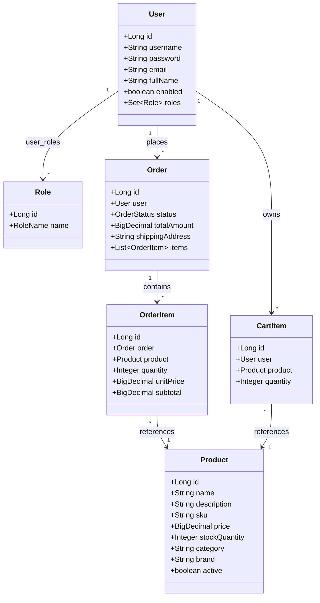
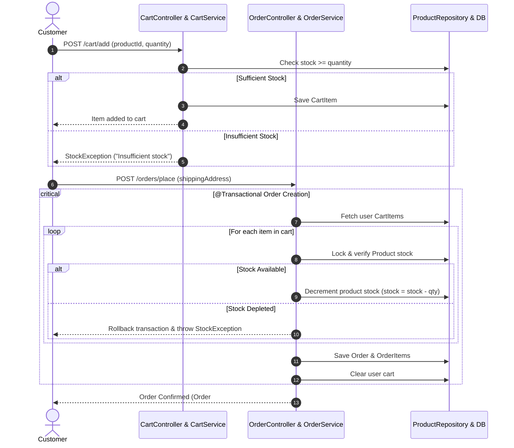
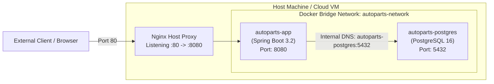

# System Architecture — Automobile Spare Parts Portal

## 1. High-Level Architecture Diagram

```mermaid
graph TD
    subgraph Client Tier
        UserBrowser["Web Browser (User / Admin)"]
        UI_Components["Thymeleaf Templates + Bootstrap 5 + JS"]
    end

    subgraph Presentation & Application Tier
        Nginx["Nginx Reverse Proxy / Load Balancer (Port 80)"]
        
        subgraph Spring Boot 3.2 Application (Embedded Tomcat :8080)
            Security["Spring Security (BCrypt, Session Auth, CSRF)"]
            Controllers["MVC Controllers (Auth, Product, Cart, Order, Admin)"]
            Services["Business Services (ProductService, OrderService, etc.)"]
            Repositories["Spring Data JPA Repositories"]
        end
    end

    subgraph Data Tier
        Postgres[("PostgreSQL 16 Database (:5432)\nACID Transactions")]
        H2DB[("H2 In-Memory Database\n(Automated Testing)")]
    end

    UserBrowser -->|HTTPS / HTTP| Nginx
    Nginx -->|Reverse Proxy| Security
    Security --> Controllers
    Controllers --> Services
    Services --> Repositories
    Repositories -->|Production JDBC| Postgres
    Repositories -->|Test Profile JDBC| H2DB
```

---

## 2. Component Architecture



---

## 3. Transactional Stock Validation & Order Flow



---

## 4. Deployment Topology


