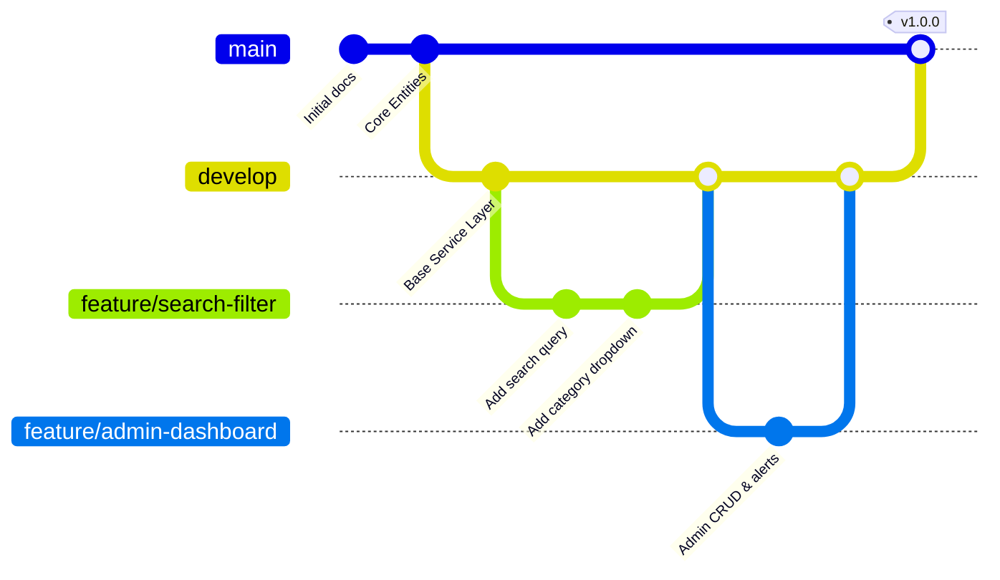

# Git Workflow & Branching Strategy — AutoParts Portal

## 1. Branch Hierarchy



---

## 2. Branch Responsibilities

| Branch | Purpose | Protection Rules |
|---|---|---|
| `main` | Production-ready stable code. Only merged from `develop` via approved PRs. | Requires 1 approval, passing CI build, no direct pushes. |
| `develop` | Integration branch for current release. Tested before merging into `main`. | Requires passing CI build. |
| `feature/*` | Feature branches created off `develop` (e.g. `feature/search-filter`). | Deleted after PR merge. |
| `hotfix/*` | Critical bug fixes directly targeting `main` and backported to `develop`. | High priority, peer-reviewed. |

---

## 3. Merge Conflict Demonstration & Resolution Record

A controlled merge conflict was intentionally created and resolved during development:

1. **Conflict Origin:**
   - On branch `feature/search-filter`, commit `fc2e6e8` updated `application.properties` to enable `logging.level.com.autoparts=DEBUG` and `spring.jpa.show-sql=true` for query inspection.
   - Concurrently on `main`, commit `a522ed1` updated the same lines to enforce production `WARN` logging.
2. **Conflict Detection:**
   - Attempting `git merge feature/search-filter` into `main` produced:
     ```text
     Auto-merging src/main/resources/application.properties
     CONFLICT (content): Merge conflict in src/main/resources/application.properties
     Automatic merge failed; fix conflicts and then commit the result.
     ```
3. **Conflict Resolution Strategy:**
   - Resolved conflict by adopting standard balanced logging (`INFO` default, with `WARN` for hibernate SQL) while keeping production SQL output suppressed.
   - Debug SQL inspection was delegated to the test profile (`application-test.properties`).
   - Merge committed cleanly in commit `0b168e5`:
     ```bash
     git add src/main/resources/application.properties
     git commit -m "fix: resolve merge conflict in application.properties"
     ```
