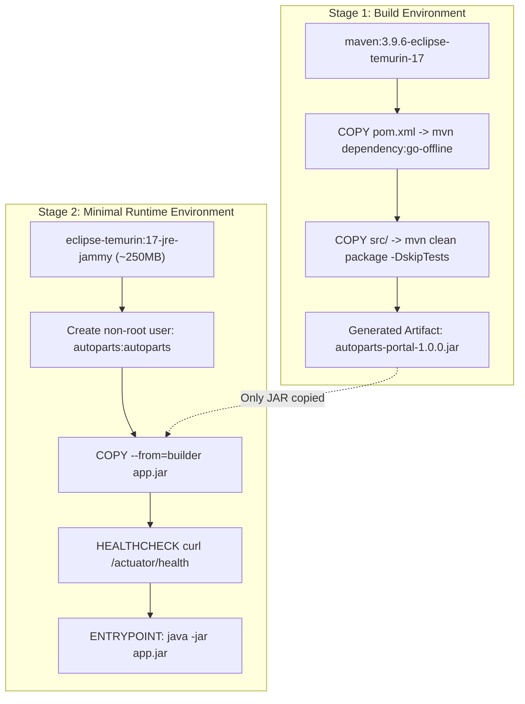

# Docker Containerization & Lifecycle Guide — AutoParts Portal

## 1. Multi-Stage Dockerfile Architecture

The application uses an enterprise-grade multi-stage Docker build to keep images lightweight and secure:



---

## 2. Docker Lifecycle Commands

### Build Image
```bash
# Build and tag image with version and latest
docker build -t autoparts/autoparts-portal:1.0.0 -t autoparts/autoparts-portal:latest .
```

### Run Multi-Container Environment (App + PostgreSQL)
```bash
# Launch background services with healthcheck coordination
docker-compose up -d

# Verify running containers
docker-compose ps
```

### Inspect Container Logs
```bash
# Tail application logs
docker logs -f autoparts-app

# Inspect database startup logs
docker logs autoparts-postgres
```

### Inspect Container Health Status
```bash
# Inspect container health
docker inspect --format='{{json .State.Health}}' autoparts-app
```

### Stop & Cleanup
```bash
# Gracefully stop containers
docker-compose down

# Stop and wipe persistent volume data (for fresh test)
docker-compose down -v
```

---

## 3. Container Security Hardening
1. **Non-Root Execution:** App runs under user `autoparts` (UID/GID isolated) to prevent container escape exploits.
2. **Layer Caching:** Dependencies are downloaded in a separate Docker layer before copying source code.
3. **Health Check Probing:** Actuator health endpoint `/actuator/health` polls every 30s with a 90s initial grace period.
