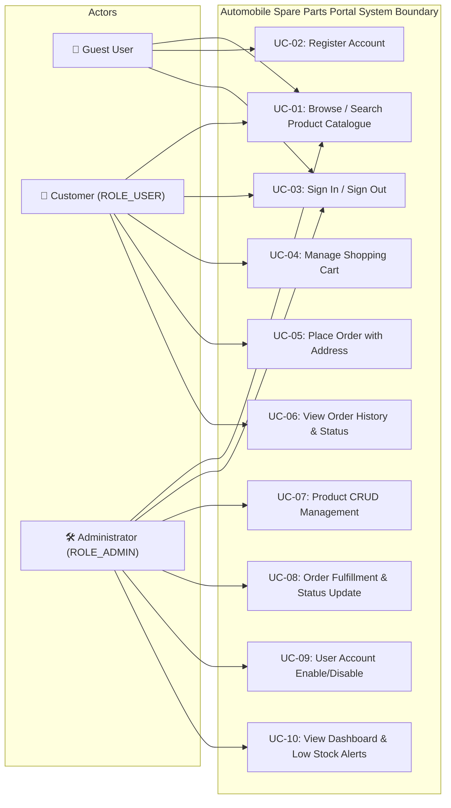

# Use Case Specifications — Automobile Spare Parts Portal

## 1. Use Case Diagram

---

## 2. Detailed Use Case Specifications

### UC-01: Browse & Search Product Catalogue
- **Primary Actor:** Guest / Customer / Admin
- **Preconditions:** Portal accessible via web browser.
- **Main Flow:**
  1. User navigates to `/products`.
  2. System displays paginated catalogue of active parts (12 per page) with name, category, price, stock status, and image.
  3. User enters keywords in the search bar or selects a category from the dropdown.
  4. System dynamically filters products matching title/description and category.
- **Postconditions:** Matching products displayed with pagination controls.

---

### UC-05: Place Order with Transactional Stock Validation
- **Primary Actor:** Authenticated Customer
- **Preconditions:** Customer logged in; shopping cart contains at least one item.
- **Main Flow:**
  1. Customer reviews cart and clicks "Proceed to Checkout".
  2. System presents shipping address form (`/orders/checkout`).
  3. Customer submits shipping address.
  4. System initiates a database transaction:
     - Verifies each cart item has `stock_quantity >= cart_quantity`.
     - Decrements `products.stock_quantity` by ordered quantity.
     - Creates `Order` with `status = PENDING`.
     - Creates associated `OrderItem` records.
     - Empties customer's cart.
     - Commits database transaction.
  5. System redirects to `/orders` with flash notification and order total.
- **Alternative Flow (Stock Insufficient):**
  - If any product stock has been depleted by concurrent orders, system aborts transaction, leaves cart intact, and displays: *"Insufficient stock for [Product Name]. Available: X, Requested: Y."*

---

### UC-07: Product CRUD & Stock Management
- **Primary Actor:** Administrator (`ROLE_ADMIN`)
- **Preconditions:** Admin signed in.
- **Main Flow:**
  1. Admin navigates to `/admin/products`.
  2. Admin can create new product via `/admin/products/new`:
     - System validates SKU uniqueness, name length (2–200 chars), price > 0, and non-negative stock.
  3. Admin can edit product details, adjust stock count, or soft-delete products (`active = false`).
- **Postconditions:** Catalogue reflects product updates immediately.

---

### UC-10: View Admin Dashboard & Low-Stock Alerts
- **Primary Actor:** Administrator
- **Preconditions:** Admin signed in.
- **Main Flow:**
  1. Admin navigates to `/admin`.
  2. System computes and displays:
     - Total active products
     - Total registered users
     - Total orders placed
     - Low stock items (`stock_quantity < 5`) highlighted in amber/red alert table.
     - Recent orders list with real-time status.
